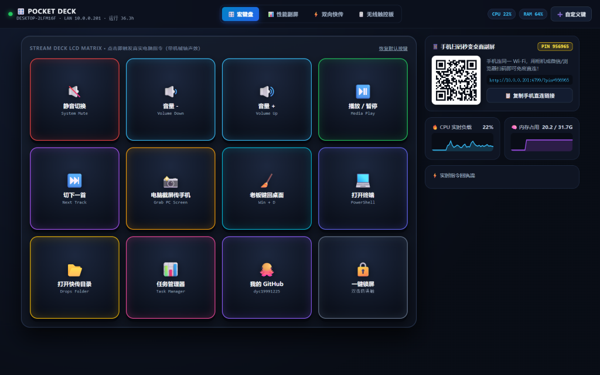

<p align="center">
  
</p>

# Pocket Deck 🎛️📱（手机/平板秒变电脑无线宏键盘 · 性能副屏 · 局域网秒传舱）

**零外部依赖 (`0 npm dependencies`) · 一条命令秒起 · 手机扫码免装 App 即连！**

不用花 ¥1000+ 买实体 Stream Deck！只需在电脑运行 `node bin/pocket-deck.mjs`，用你的手机或闲置旧平板扫描屏幕二维码（同一 Wi-Fi），立刻解锁四大桌面效率神器：

1. **🎛️ 拟物 3D OLED 宏键盘 (`Stream Deck`)**：内置静音、音量调节、切歌/暂停、`Win+D` 老板键、一键终端、任务管理器、电脑截屏传手机，自带清脆 **Cherry-MX 机械轴合成音效 + 手机马达震动反馈**，支持自由添加自定义网址与快捷键！
2. **📊 实时硬件性能副屏 (`Live Telemetry`)**：基于 SSE 毫秒级推送 **CPU 每核心实时负载柱状矩阵、内存趋势波形图、系统盘空间与内存占用 Top 5 进程**，自带屏幕常亮锁（`WakeLock`），横放显示器下方就是最酷赛博副屏！
3. **⚡ 局域网零流量双向秒传舱 (`AirDrop & Clipboard`)**：
   - **剪贴板互传**：手机复制的验证码、长链接一键塞进电脑剪贴板直接 `Ctrl+V`，或一键提取电脑当前剪贴板；
   - **纯内网高速传文件 + 电脑全屏截图**：零云端、不走外网流量，手机相册原图秒传电脑 `drops/` 目录，也能在手机上 1 秒抓取电脑当前屏幕画面！
4. **🖱️ 沙发/床头无线触控板 (`Wireless Trackpad & PPT`)**：驻留式原生 Win32 桥接进程（`< 5ms` 极低延迟），单指滑动控制电脑鼠标、滚轮上下翻页、PPT 全屏放映翻页笔，躺在床上也能遥控电脑看剧！

---

## 🚀 3 秒快速启动

```bash
git clone https://github.com/dyc19991225/pocket-deck.git
cd pocket-deck
npm start
```

启动后在电脑浏览器打开 `http://127.0.0.1:4799/`，拿出手机扫页面右侧自动生成的 **纯原生 SVG 二维码**（内置 6 位安全配对码防局域网蹭连）即可直接控制！

## 🧪 运行自动化测试

```bash
npm test
```

## License

MIT © dyc19991225
